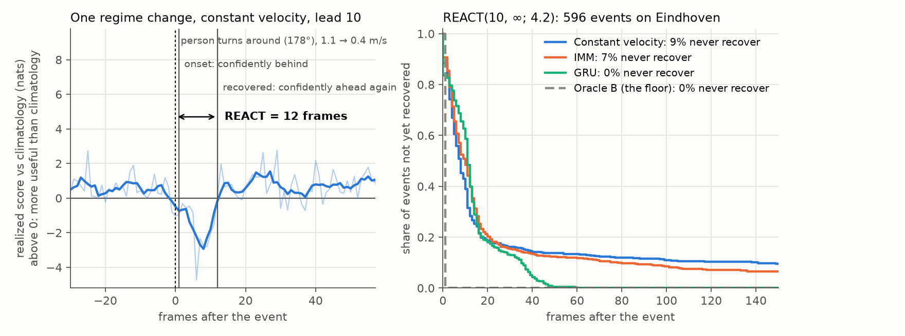

# reactmetric

**How long does a trajectory forecast stay wrong after someone changes what they are doing?**

People stop, turn around, speed up and slow down. Those moments are a small share of the
frames in any dataset, and they are when a robot or a crowd model most needs its forecast.
Averages such as ADE, FDE and NLL spread them across everything else, so two forecasters with
the same average can differ completely in how they handle a change. REACT (Regime Event
Adaptive Correction Time) finds the changes and measures what happens to each forecast around
them.



*Left: a pedestrian turns around and slows. Constant velocity's forecast 10 frames ahead falls
behind a simple climatological reference at once and is confidently ahead again 12 frames
later: REACT = 12. Right: the same measurement over 596 events. Constant velocity recovers
soonest at first, but never recovers on 9% of events; the GRU starts slower and recovers on all
of them. Oracle B is the best any forecast could do. Data: 400 Eindhoven Centraal tracks.*

## What it tells you

For every detected change in motion, and every model, REACT reports:

- **Anticipated:** the forecast never fell confidently behind the reference.
- **REACT:** frames until it was confidently ahead again, summarized with Kaplan–Meier curves
  because some recoveries are cut off by the end of the window.
- **Never recovered:** still behind when the window closed.
- **Relapsed:** recovered, then fell behind again straight away.

These are separate questions with separate answers. In the paper's experiments, learned
forecasters win on displacement and likelihood and recover more completely, yet simple
kinematic models often recover sooner right after a change, especially at longer leads. A
single leaderboard number would hide that.

Each result carries its assumptions in its name, `REACT(h, d; I)`: the lead `h`, an optional
spatial target `d` (the forecast must also localize the person within `d` metres), and the
assumed information level `I`. Track-level bootstrap intervals and paired model comparisons
come with it.

## Quickstart

```bash
pip install "reactmetric[viz]"
```

```python
import reactmetric as rm

data = rm.datasets.load_eindhoven_sample()           # 40 real tracks; or your own, below
calib, test = data.split(fraction=0.3, seed=0)

scorer = rm.ReactScorer.fit(calib, info=(4.2,), leads=(10,), distortions=(0.1,))
result = scorer.evaluate(
    {"MyModel": my_forecaster,                       # anything with predict(traj)
     "ConstantVelocity": rm.baselines.ConstantVelocity.fit(calib)},
    test,
)
print(result.table(lead=10))                         # REACT(10, ∞; 4.2), one row per model
print(result.compare("MyModel", "ConstantVelocity", lead=10))   # difference with a 95% CI
result.to_json("react.json")                         # rm.ReactResult.load("react.json")
```

`python examples/quickstart.py` runs the whole workflow with three baselines in a couple of
minutes. The [tutorial notebook](https://github.com/standard-ai/react/blob/main/examples/tutorial.ipynb) walks through it on real data,
including how to choose which events to measure.

## What you need

- **Tracks:** positions in metres, one array per track, observed at a fixed interval. Leads
  and windows are counted in observations; the defaults are the paper's, and
  [docs/concepts.md](https://github.com/standard-ai/react/blob/main/docs/concepts.md) says how to set them for your data.
- **Held-out calibration tracks** from the same setting. REACT fits its reference, noise floor
  and truth model on them once, and every model is then scored against that same fit.
- **Forecasts** at every frame you want scored, in one of these forms:
  - a Gaussian per issue frame and lead (`rm.Predictive`);
  - a mixture (`rm.MixturePredictive`), scored as a mixture;
  - sampled trajectories (`rm.SampleForecaster`), turned into a density with a bandwidth
    fitted on the calibration tracks;
  - a table on disk (`rm.Forecasts.from_dataframe`, or `reactmetric evaluate` on the command
    line).

  The issue frame is the last frame the forecast saw, and lead `h` targets the frame `h`
  later, as in ETH/UCY and Argoverse. [docs/forecasters.md](https://github.com/standard-ai/react/blob/main/docs/forecasters.md) shows each
  form in a few lines.
- **Events:** detected from the tracks by default; bring your own times if you have labels.

## How it decides

At each frame REACT compares your forecast's log density at the observed position with that
of a climatology: where a person tends to be `h` frames later given only their last step. One
frame's comparison is noisy, so REACT models the latent truth around each position and
decides, with posterior probability at least 0.95, when the forecast is truly behind (the
onset) and when it is truly ahead again (the recovery). The truth model, the events and the
reference are shared by every model on a dataset; only the forecast density differs. Oracle B,
the best forecast those assumptions allow, is scored alongside as the floor.
[docs/concepts.md](https://github.com/standard-ai/react/blob/main/docs/concepts.md) has the details.

## Install

```bash
pip install reactmetric                  # numpy and scipy only
pip install "reactmetric[viz]"           # + pandas tables and matplotlib plots
pip install "reactmetric[torch]"         # + the pretrained GRU baselines
pip install "reactmetric[datasets]"      # + the full Eindhoven data (parquet)
```

Python 3.10 or newer.

## Citing

Breseman, C. and Woollard, D. M. *REACT: Measuring Regime Adaptation in Trajectories.*
Collective Dynamics (TGF 2026). The paper's code and outputs are in
[react-reproducibility](https://github.com/calvin-breseman/react-reproducibility).

```bibtex
@article{breseman2026react,
  title   = {{REACT}: Measuring Regime Adaptation in Trajectories},
  author  = {Breseman, Calvin and Woollard, David M.},
  journal = {Collective Dynamics},
  year    = {2026},
  note    = {Traffic and Granular Flow (TGF 2026)}
}
```

The bundled sample and the pretrained GRUs use the Eindhoven Centraal pedestrian data of Pouw,
van der Vleuten, Corbetta and Toschi
([doi:10.5281/zenodo.13784588](https://doi.org/10.5281/zenodo.13784588), CC-BY-4.0); please
cite it too if you use them.

## License

Apache-2.0. Developed at Standard Labs, a lab within Standard AI, by Calvin Breseman and
David M. Woollard.
