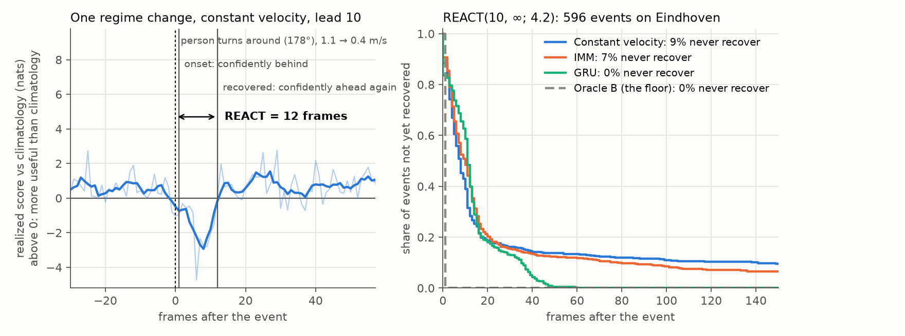

# reactmetric

**How long does a trajectory forecast stay wrong after someone changes what they are doing?**

People stop, turn around, speed up and slow down. Those moments are a small share of the frames
in any dataset, and they are when a robot or a crowd model most needs its forecast. Averages such
as ADE, FDE and NLL spread them across everything else. REACT (Regime Event Adaptive Correction
Time) finds the changes and measures, for each forecast, whether it anticipated them, how long it
took to be confidently useful again, whether it got there at all, and whether the recovery held.



The method is that of Breseman and Woollard, *REACT: Measuring Regime Adaptation in
Trajectories* (Collective Dynamics, TGF 2026). The paper's own code is at
[react-reproducibility](https://github.com/calvin-breseman/react-reproducibility); this library
computes the same numbers, and its tests check that.

## Start here

```bash
pip install "reactmetric[viz]"
```

```python
import reactmetric as rm

data = rm.datasets.load_eindhoven_sample()           # or rm.TrajectorySet.from_dataframe(...)
calib, test = data.split(fraction=0.3, seed=0)

scorer = rm.ReactScorer.fit(calib, info=(4.2,), leads=(10,))
result = scorer.evaluate({"MyModel": my_forecaster,
                          "ConstantVelocity": rm.baselines.ConstantVelocity.fit(calib)}, test)
result.table(lead=10)
```

- [Bring your own forecaster](forecasters.md): the four forms a forecast can take.
- [Choosing events](events.md): which changes in motion to measure.
- [Reading results](results.md): the columns, confidence intervals, saving.
- [The REACT metric](concepts.md): how the decisions are made, the defaults, other frame rates.
- [Tutorial](tutorial.ipynb): the whole workflow on real Eindhoven data.
